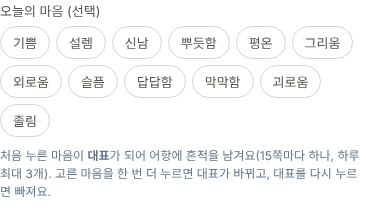
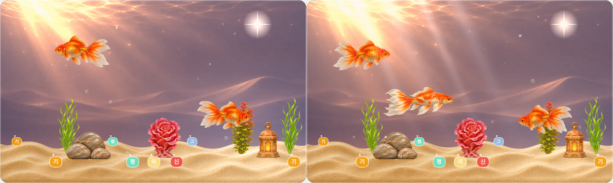

# 감정 흔적 — 엔진 0.3.0 구현 1단계 (감정 규칙·데이터 호환, 임시 도형)

기획: [EMOTION_DICTIONARY.md](EMOTION_DICTIONARY.md)(2026-11-18 확정). 이번 PR은 구현 순서 E의 **1번**이에요. 그림 없이 임시 도형으로 규칙과 호환만 만들어요.
- 이번에 하지 않은 것: 상징 그림(2번, 시제품 2~3종부터), 원근 3층(3번), 물 흐름·속도와 나머지 확장(4번)

## 엔진 버전: 어항은 만들 때 버전으로 끝까지
- `ENGINE_VERSION = '0.3.0'`. 계산할 수 있는 버전은 `SUPPORTED_ENGINES = ['0.2.0', '0.3.0']`이에요.
- 어항의 엔진 버전은 **0번 스냅샷의 `engineVersion`** 이에요. 그 어항의 모든 스냅샷은 그 버전 규칙으로 계산해요(`TankSession.engineVersion`).
  - 새 어항은 0.3.0이에요. 0.2.0 어항은 0.2.0 규칙으로 끝까지 계산해요.
  - 계산 코드를 보관하지 않는 옛 버전(0.1.0)은 0.2.0 도입 때처럼 `FALLBACK_ENGINE = '0.2.0'`으로 이어서 계산해요.
- 무결성 I2(다시 계산)는 각 스냅샷의 버전 규칙으로 확인해요. 그래서 0.2.0·0.3.0 스냅샷 모두 다시 계산해 볼 수 있어요.
- **0.2.0 동작 고정**: 0.2.0 계산 코드는 따로 복사하지 않고 같은 코드에서 버전으로 갈라요. 대신 아래 두 가지가 바뀌지 않는지 테스트로 확인해요.
  - 골든 `0.2.0 = b8124dae:a2f000ff`
  - 검증실 샘플 **75개 어항 전체**를 0.2.0으로 돌린 스냅샷 체인 해시(`engine/__tests__/frozen-0.2.0.json`, 0.3.0 작업 전 main에서 뽑음)
  - 0.3.0 골든: `d2abb0f8:b02fe9e4`

## 감정 사전: 고정 id + 표시명 + 옛 이름
- 12개 감정(`EMOTIONS`): 기쁨·설렘·신남·뿌듯함·평온·그리움·외로움·슬픔·답답함·막막함·괴로움·졸림
- 옛 칩 이름은 별칭으로 같은 감정에 연결돼요: 따뜻함→기쁨, 유쾌함→신남, 차분함→평온, 쓸쓸함→외로움, 자신감→뿌듯함, 힘듦→괴로움
- 저장된 `moodChips`는 **기록할 때의 단어 그대로** 둬요. 계산할 때만 id로 읽어요. 기억 카드에도 그날 고른 단어가 보여요(예: "차분함" 칩 + "평온에서 별빛 해파리가 생겼어요").
- 한마디 분석도 버전별이에요. 0.2.0 어항의 "슬펐다"는 계속 쓸쓸함이고, 0.3.0 어항에서만 슬픔이에요(소급 재분류 없음).

## 대표 감정
- 처음 누른 칩이 대표(맨 앞)예요. 고른 칩을 다시 누르면 대표가 되고, 대표를 다시 누르면 빠져요(`ui/chips.ts`). 칩에 "대표" 표시가 붙어요.
- 칩 없이 한마디만 쓰면, 분석 확신도가 기준(0.3) 이상일 때 그 첫 감정을 대표로 써요.
- 감정을 알 수 없는 기록은 흔적을 만들지 않아요. 그 쪽수는 모으지도 않고(나중 감정의 흔적이 되지 않게), 완독 목표(총 쪽수 ÷ 15)에만 들어가요.

## 흔적 규칙 (결정 1·2 그대로, 숫자는 `TRACE`)
- 읽은 **15쪽마다 흔적 1개**예요. 쪽수는 **감정별로 따로 모아요**(PR #24 재리뷰 반영, 출처 귀속 정책).
  - 같은 감정의 쪽수가 15쪽 차야 그 감정의 흔적이 돼요. **서로 다른 감정은 섞지 않아요**. 예: 슬픔 14쪽 + 기쁨 1쪽은 흔적이 되지 않고, 각자 남아요.
  - 출처 기록은 그 15쪽에 **가장 많이 기여한 기록**이에요(같으면 먼저 온 기록). 기억 카드는 그 기록을 보여 줘요.
  - 여러 기록이 모여 찼으면 문구가 "1월 1일부터 모인 설렘에서 …"예요.
  - **감정을 알 수 없는 기록의 쪽수는 모으지 않아요.** 나중 감정의 흔적을 만들지 않고, 완독 목표에만 들어가요.
  - 15쪽이 안 찬 감정별 나머지는 완독 채움("그동안의 ○○이 모여")에서 감정 비율로 반영돼요. 특정 기록인 척하지 않아요.
- **하루 최대 3개**예요. 넘친 몫은 **원래 기록의 감정·순번·날짜와 함께 대기열(`queue`)** 에 넣고, 다음 기록에서 먼저 미룬 것부터 놓아요(PR #24 리뷰 반영).
  - 나중에 놓여도 흔적의 감정은 원래 기록의 감정이에요. 예: 1일 차 슬픔 100쪽 → 2일 차 기쁨 0쪽이면, 2일 차에 놓이는 3개는 기쁨이 아니라 **슬픔**이에요.
  - 문구는 "1월 1일의 슬픔이 이어져 푸른 눈물 진주가 생겼어요"예요. 변화에 `sourceSeq`(원래 기록 순번)를 남겨서 **기억 카드도 원래 기록**(그날 쪽·마음·한마디)을 보여 줘요.
  - 감정을 알 수 없는 기록의 쪽수는 대기열에 넣지 않아요. 나중의 다른 감정으로 바뀌지 않게요. 그 쪽수는 완독 목표(총 쪽수 ÷ 15)에만 들어가요.
- 같은 감정은 **다른 자리에 최대 4개**까지 놓이고, 그다음부터는 가장 덜 자란 것이 **한 단계씩 자라요**(최대 3단계). 같은 흔적은 **3일에 한 번**만 자라요.
- 더 놓을 자리도, 키울 흔적도 없으면 "흔적들이 반짝였어요"만 나와요.
- **완독 채움**: 먼저 대기열에 남은 흔적을 원래 감정·출처 그대로 놓아요. 그래도 목표 = max(8, 총 쪽수 ÷ 15)(자유형은 읽은 쪽)보다 모자라면 기록한 대표 감정 비율대로 채워요.
  - 완독 채움에서는 감정당 최대 8개까지 놓을 수 있어요.
  - 한 감정이 가득 차면 남은 몫을 다른 기록한 감정에 나눠요.
  - 문구는 "그동안의 ○○이 모여 …"예요. 기억 카드에서도 그렇게 보여요(특정 하루의 기록인 척하지 않아요).
- 기본 생태계(물고기·수초·수석·장식)는 예전 규칙 그대로예요(성장점, 하루 1회, 새 오브젝트 하루 1개). 감정 흔적과 **따로 세요**.
  - 흔적은 자기 줄(먼 줄 y 478, 바닥 앞줄 y 548)에 놓여요. 생태계 줄과 높이가 달라 서로 자리를 막지 않아요.
- 흔적 배치는 생태계와 다른 난수 흐름을 써요.

## 화면 (그림, 2026-11-18)
12종 기본 그림을 넣었어요(규격·파일은 [ASSET_SPEC.md](ASSET_SPEC.md#감정-상징-12종-기본-그림-2026-11-18-엔진-030-감정-흔적)). 그림이 없는 요소만 아래 임시 도형으로 그려요.
- 신남은 한 그림으로 무리(단계 1→3: 3→5마리), 외로움은 혼자 아래쪽 레인, 평온은 물속에 떠서 오르내림, 나머지는 바닥 장식이에요.
- 엔진은 그대로예요(렌더러·매니페스트만). 골든 불변.

*개발 환경(헤드리스 크롬) 정지 그림: 360쪽, 12가지 감정을 15쪽씩 돌아가며 기록한 뒤 완독(흔적 24개).*

## 화면 (임시 도형, 그림이 없을 때)
- 감정마다 색과 글자 하나(예: 그리움 "그"), 위에 자람 단계 점을 보여 줘요(`render/TraceView.ts`). 먼 줄은 조금 작게 그려요.
- 누르면 기억 보기 카드가 떠요(💠). 미뤄졌다 놓인 흔적은 **감정이 기록된 날**과 **어항에 나타난 날**을 함께 보여 줘요.
  - 완독 때 자란 감정 흔적은 "완성하며 자란 날"로 보여요. 대표 생물(물고기)만 "대표 생물이 된 날"이에요.
  - 한 스냅샷에서 같은 흔적이 여러 단계 자라면 변화마다 따로 보여 줘요.

*개발 환경(헤드리스 크롬) 화면이에요. 왼쪽은 어린왕자 14일, 오른쪽은 완독 후예요(140쪽은 목표 9개를 이미 채워서 더 채우지 않음).*

## 시나리오 확인 (자동, 샘플)
대표 감정 4가지 순환, 하루 한 번 기록. 감정별로 쪽수를 모으므로 감정이 자주 바뀌면 기록 중 흔적이 조금 적고, 완독 채움이 그만큼 채워요

| 책 · 기간 | 목표 | 완독 전 흔적(놓인 개수) | 완독 후(놓인 개수) | 기본 생태계 |
|---|---|---|---|---|
| 140쪽 · 7일 | 9 | 7 (7개) | 9 (9개) | 6 |
| 140쪽 · 28일 | 9 | 8 (8개) | 9 (9개) | 14 |
| 300쪽 · 7일 | 20 | 17 (14개) | 20 (17개) | 6 |
| 300쪽 · 30일 | 20 | 18 (16개) | 20 (18개) | 14 |
| 500쪽 · 10일 | 33 | 30 (16개) | 33 (19개) | 8 |
| 500쪽 · 60일 | 33 | 32 (16개) | 33 (17개) | 18 |
| 자유형 200일 · 하루 20쪽(12감정) | — | 90 (30개) | 진행 중 | 19 |

- 흔적 수 = 놓이거나 자란 횟수예요. 놓인 개수는 자리 수(두 줄 × 15칸, 간격 55)에 막혀 30개 근처에서 멈추고, 그다음부터는 자람으로 쌓여요.
- 원근 3층(3번)에서 자리가 늘어나요.

## 검증실·평가 도구 영향
- 검증실 '실제 기록 읽기 전용 보기'의 무결성 검사(`verifyUserData`)도 엔진과 같은 기준이에요. 보관 중인 버전(0.2.0·0.3.0)은 각 버전 규칙으로 다시 계산(I2)하고, 보관하지 않는 옛 버전(0.1.0)만 건너뛰어요(PR #24 리뷰 반영).
- 재현성 확인 버튼도 어항의 엔진 버전으로 다시 재생해요.
- 검증실 규칙 검사: R1·R2(하루 1개·1회)는 기본 생태계만 세요. 감정 흔적 하루 3개 이하는 **R7**로 새로 확인해요.
- V1 시각 평가 어항은 이제 0.3.0으로 만들어져요(흔적 포함). 이전 평가 세션(0.2.0)은 "다른 엔진 버전"으로 판정에서 빠져요. 흔적 전용 평가(상징 찾기·감정 맞히기)는 그림이 나온 뒤(2번) 만들어요.

## 성능
- 흔적 1개당 도형 3개(조약돌·글자·점)예요. 200일 어항 기준 30개 정도라 부담이 작아요.
- 매 프레임 움직이지 않아요(정지). 실제 그림으로 바꿀 때 다시 측정해요.
