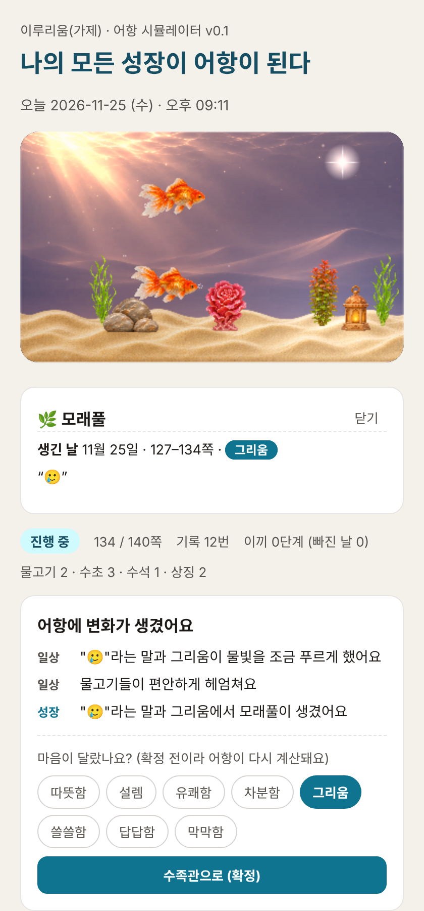

# 기억 보기 (1단계)

atmos-2 평가 뒤 기획자 의견: "매번 책을 읽을 때 그때그때의 감정이 모여서 어항이 만들어져야 하는데, 지금은 포괄적이다. '저번에 저건 왜 그렇게 생각해서 저 수초가 생겼더라?' 하면서 만들어지는 거다."
이번 단계는 그중 **"왜 생겼더라?"를 떠올리게 하는 기능**만 해요. 감정 사전(감정마다 자기 상징), 물 흐름·헤엄 속도, 원근 배치는 2단계 기획 문서에서 정하고, 3단계에서 엔진 버전을 한 번 올려 같이 구현해요.

## 무엇을 하나
- 어항 속 물고기·수초·수석·상징을 누르면 아래에 카드가 떠요.
  - **생긴 날**: 날짜 · 읽은 쪽 범위 · 그날 고른 마음 · 한마디
  - **함께 자란 날**: 그 요소가 자란 기록들(3번 이하면 펼쳐 둠)
  - 완성 때 나온 대표 생물은 "완성한 날"로 보여요
- 아무것도 안 눌렀을 땐 "어항 속 물고기·수초·장식을 누르면…" 안내가 보여요.

*개발 환경(헤드리스 크롬, 모바일 화면 크기) 화면이에요.*

## 어떻게 찾나 (읽기 전용, 엔진 변경 없음)
- `src/ui/memory.ts`의 `memoryOf()`가 이미 저장된 스냅샷만 읽어요. 엔진·스냅샷·골든은 그대로예요.
- 머리 스냅샷에서 `baseId`를 따라 빈 어항까지 거슬러 간 사슬만 봐요. 폐기된 미확정 스냅샷은 사슬에 없어서 섞이지 않아요.
- 생긴 날 = 사슬에서 그 요소가 처음 나타난 스냅샷이에요. 자란 날 = 그 뒤 그 요소를 가리키는 변화가 있는 스냅샷이에요.
- 내용은 **그때 계산에 쓴 입력**(`snapshot.input`)으로 보여 줘요. 나중에 기록을 고쳐도 "왜 생겼는지"는 그대로라서예요. 고친 기록에는 그 사실을 표시해요.
- **확정 후 지운(숨김) 기록**에서 생긴 요소는 어항에 남아요. 대신 카드에는 날짜만 보이고 마음·한마디는 숨겨요.

## 누르기 판정
- 렌더러의 `setObjectTapHandler()`로 켜요. 앱 화면만 켜고, 검증실·정지 그림은 끈 채로 둬요(꺼져 있으면 `eventMode = 'none'`).
- 물고기는 몸이 가늘어 누르기 어려워서 그림 상자 전체를 누를 수 있게 했어요(움직이는 물고기도 따라감).
- 성능: 누를 때만 판정해요. 매 프레임 추가 계산은 없어요.

## 아직 안 한 것
- 누른 요소를 화면에서 강조 표시하기(어떤 걸 눌렀는지 테두리·반짝임)
- 수초 뒤에 겹친 작은 물고기는 앞 요소가 먼저 눌릴 수 있어요
- 실제 휴대폰에서 손가락으로 누르기 편한지 확인
