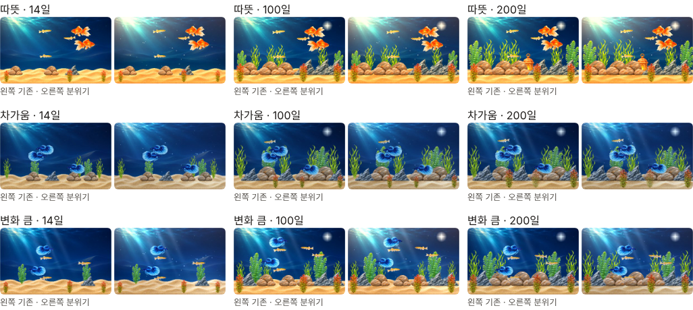

# 감정별 어항 분위기 차별화 — 1차 실험 (atmos-1)

V1 사람 평가(기존 렌더링 v0)에서 "감정이 달라도 구분이 잘 안 가고 개성이 없다"는 결과가 나왔어요([VISUAL_EVAL.md](VISUAL_EVAL.md#사람-평가)).
이번 실험은 **첫인상의 분위기(물색·빛·입자)만** 감정에 따라 연속적으로 바꿔요. 판단은 자동 수치가 아니라 **atmos-1로 다시 하는 사람 평가**로 해요.

## 바꾸지 않은 것
- 엔진 `ENGINE_VERSION 0.2.0`, 성장 규칙, 스냅샷·골든(`b8124dae:a2f000ff`), 무결성 검사, 자동 품질 조절은 그대로예요.
- 새 에셋은 없어요. 테마·물고기·수초·장식, 배치, 저장/복원, UI 구조도 그대로예요.
- H9·H10은 이번 PR에 넣지 않았어요.

## 무엇을 바꿨나
렌더러에 `atmos` 레이어를 **배경 바로 위, 생물 뒤**에 추가했어요. 그래서 생물 색은 덮지 않아요.

| 요소 | 방식 | 따뜻함 | 차가움 | 변화 큼 |
|---|---|---|---|---|
| 위층 물빛 | 위→아래로 옅어지는 **가산(add)** 빛 | 노을 살구·금빛 | 새벽 청색 | 따뜻한 빛이 위에 |
| 아래층 물빛 | 아래→위로 옅어지는 **곱하기(multiply)** 거름 | 파랑을 걸러 금빛 | 빨강·초록을 걸러 남색 | 차가운 깊이가 아래에 |
| 보조 빛 | 가산 빛 두 개(따뜻/차가움) | 따뜻한 빛 | 흰 청색 빛 | 둘 다 |
| 입자 | 작은 빛 알갱이(fx 레이어) | 따뜻한 색, 위로 떠오름 | 흰 청색, 천천히 가라앉음 | 섞여서 |

- **연속 매핑**: 엔진이 이미 계산한 `light.temp`·`light.energy`와, 최근 14일 감정 온도의 표준편차 `moodSpread`만 써요. 감정을 몇 개 칸으로 나누지 않고 부드럽게 섞어요.
- **`moodSpread` 계산 규칙** (`moodSpreadOf(trail, asOf)`):
  - 기준 날짜 `asOf`를 포함한 최근 **14개 달력 날짜**(asOf−13일 ~ asOf) 안의 기록만 써요. 기록 개수 14개가 아니에요. 그래서 오래 쉬었다 돌아온 사용자의 옛 감정이 최근 분위기로 섞이지 않아요.
  - 기준 날짜: 앱은 오늘 날짜, 검증실은 그 프레임의 날짜예요.
  - 기록이 없는 날은 중립(0)으로 채우지 않고 **미관측**으로 빼요.
  - 같은 날 여러 번 기록은 엔진이 이미 하루 1개로 합쳐 둬요(하루 1일치 무게).
  - 기준 날짜보다 뒤 기록은 안 써요. 창 안 기록이 2개 미만이면 0이에요.
  - 따뜻함/차가움: `temp / 0.35`를 부드럽게(엔진 차가움 어항의 temp는 약 -0.22라 0.6으로는 너무 약했어요).
  - 대비(변화 큼): `moodSpread` 0.36에서 시작해 0.55에서 꽉 차요. 같은 계열끼리 오가는 차가움 어항(약 0.32)은 대비로 보지 않고, 변화 큼 어항(약 0.56~0.59)만 대비가 생겨요.
- **변화 큼은 반반 나누기나 무지개가 아니에요**: 위층은 따뜻한 쪽, 아래층은 차가운 쪽으로 기울고 그라데이션 두 층이 겹쳐요.
- **어둡지 않게**: 위층 알파 ≤ 0.3, 아래층 알파 ≤ 0.55, 곱하기 색 밝기 ≥ 150, 보조 빛 알파 ≤ 0.34. 처음엔 일반 섞기로 했더니 물이 뿌옇게 바래서 가산/곱하기로 바꿨어요.
- 상수는 샘플 어항(검증실 V1 세트)을 보며 정한 **1차 값**이에요.

## 기존 렌더링과 분리
- `RenderStyle = 'v0' | 'atmos-1'`, 기본값은 `atmos-1`이에요.
- 평가 세션에 `renderStyle`을 저장해요. 값이 없는 예전 세션은 `v0`으로 봐요.
- 결과 화면에서 렌더링을 골라 따로 판정해요. 다른 렌더링 세션은 "다른 렌더링(v0)으로 본 어항"으로 빠져서 **V1 데이터와 섞이지 않아요**.
- 평가 시작 화면에서 렌더링을 고를 수 있어요(기본 atmos-1).

## 비교 자료
검증실 → 감정 시각 평가 → 결과 화면 아래쪽에 **같은 책·같은 시드**의 따뜻함/차가움/변화 큼 × 14/100/200일을 기존(왼쪽)·분위기(오른쪽)로 나란히 보여 줘요.

*개발 환경(헤드리스 크롬, 소프트웨어 렌더링)에서 찍은 화면이에요. 실제 휴대폰 화면과 다를 수 있어요.*

### 자동 참고값: 물 가운데 색 차이 (RGB 거리, 샘플)
| 날짜 | 감정 쌍 평균 v0 | 감정 쌍 평균 atmos-1 | 시드 쌍(같은 감정) |
|---|---|---|---|
| 14일 | 24.5 | 27.8 | 0 / 0 |
| 100일 | 25.6 | 29.4 | 0 / 0 |
| 200일 | 26.3 | 29.5 | 0 / 0 |

- 덧칠 색을 대략 합성해 본 값이라 실제 화면과 같지 않아요. **이 숫자로 성공을 판단하지 않아요.**
- 같은 감정끼리는 0 그대로라, 분위기 차이가 감정에서만 생긴다는 것만 확인해요.

### 눈으로 본 1차 소견 (개발자 확인, 사람 평가 아님)
- 따뜻함: 위쪽이 금빛으로 밝아져 차이가 가장 커요. 약간 바래 보이는 느낌이 남아 있어요.
- 차가움: 원래 테마가 파란색이라 기존과 차이가 **작아요**. 사람 평가에서 약하게 나오면 다음 조정 1순위예요.
- 변화 큼: 위는 따뜻하고 아래는 푸르게 보여요.

## 성능 영향
- 추가되는 것: 물빛 스프라이트 2개 + 보조 빛 2개(고정, 매 프레임 다시 그리지 않음), 입자 스프라이트 **일반 최대 40개 / 저사양 최대 12개**(가산 섞기, 작은 텍스처 1장 공유).
- 매 프레임 일은 입자 위치 갱신뿐이에요. 감정 색 계산은 상태가 바뀔 때(`setState`)만 해요.
- 저사양(low) 모드는 입자만 줄이고 **물색·보조 빛 차이는 그대로** 유지해요.
- 움직임 줄이기 설정이면 입자가 움직이지 않아요.
- 실제 휴대폰 측정은 아직 안 했어요. 기존 성능 측정 도구(`?perf=1`)로 Fold7에서 다시 재 볼 수 있어요.

## 다음 단계
1. 머지 여부는 ChatGPT 코드 리뷰 후 결정해요.
2. 머지되면 atmos-1로 **사람 평가를 다시** 해요(V1과 같은 방식, 5명 이상).
3. 결과로 판정해요. 차가움이 약하면 그 부분만 조정해요.
