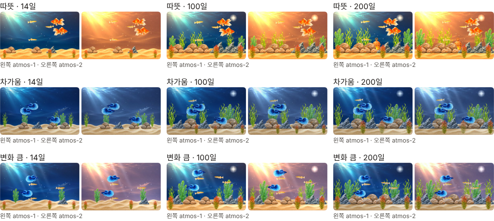
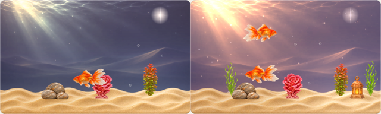

# 감정별 배경 색감 — 2차 실험 (atmos-2)

atmos-1 사람 평가에서 "다르다"는 응답은 93%로 올랐지만, **어떤 감정인지 맞힌 비율은 16%** 였어요. 평가자 의견은 "밝으면 따뜻하고 어두우면 우울하다, 두 가지밖에 안 읽힌다"였어요([VISUAL_EVAL.md](VISUAL_EVAL.md)).
이번 실험은 그중 **가설 A(감정 구별력)** 를 검증해요. 같은 배경 그림을 감정별로 다른 색감으로 바꾸고, '변화 큼'은 움직임으로도 보여 줘요. 판단은 같은 V1 평가 도구로 하는 **사람 평가**로 해요.

## 바꾸지 않은 것
- 엔진 `ENGINE_VERSION 0.2.0`, 성장 규칙, 스냅샷·골든(`b8124dae:a2f000ff`), 무결성 검사, 자동 품질 조절
- 새 에셋 없음. 물고기·수초·수석·장식·**바닥 모래**의 색과 배치는 그대로
- 원근 3층(가설 B), H9·H10, 저장/복원, UI 구조는 이번 PR에 넣지 않았어요

## 무엇을 바꿨나
### 1. 배경 그림 한 장의 색감 (듀오톤)
배경 그림의 밝기를 감정별 두 색(어두운 색 → 밝은 색) 사이로 옮겨 다시 칠해요. 그림의 모양(빛줄기·모래 언덕)은 그대로라 같은 장소의 다른 시간·날씨처럼 보여요. 빛줄기는 밝게 남아요.

| 감정 | 이름 | 어두운 곳 | 밝은 곳 | 의도 |
|---|---|---|---|---|
| 따뜻함 | 노을 라군 | 짙은 자두빛 갈색 `#3a1c2c` | 살구·금빛 `#f2b070` | 해 질 녘 금빛 물 |
| 차가움 | 달빛 새벽 | 짙은 남색 `#0a1434` | 은빛 청색 `#96b6e8` | 원래의 선명한 파랑과 다른, 채도 낮은 강철 청색 |
| 변화 큼 | 해 질 녘 | 푸른 남색 `#162860` | 복숭앗빛 `#ffaa96` | 어두운 곳은 차갑고 밝은 곳은 따뜻함(두 감정이 한 화면에, 반반 나누기·무지개 아님) |

- 가중치는 atmos-1과 같은 연속 값을 써요: 따뜻함·차가움(`light.temp`), 대비(`moodSpread`, 최근 14 달력일). 감정이 없으면 원래 배경 그대로예요.
- 감정이 섞이면 색도 연속으로 섞여요(칸 나누기 없음).
- atmos-1의 물색 덧칠·보조 빛·빛 입자는 그대로 위에 올라가요.

### 2. '변화 큼'은 움직임으로도
대비가 있을 때 따뜻한 보조 빛과 차가운 보조 빛이 **10초 주기로 번갈아** 세졌다 약해져요(감정이 오가는 느낌). 실시간 화면에서만 보이고, 정지 그림·움직임 줄이기 설정에서는 멈춰요.

### 3. 평가 도구
- 렌더링 버전 `atmos-2`를 추가하고 기본값으로 했어요. 평가 세션에 저장되고, v0·atmos-1 결과와 **따로** 판정돼요.
- 결과 화면과 정리 텍스트에 **감정 맞히기 답 분포**(실제 감정 × 고른 답, '모르겠어요' 포함)를 추가했어요. atmos-1 때 맞힌 비율이 찍기보다 낮았던 원인('모르겠어요'가 많은지, 어떤 감정과 헷갈리는지)을 이번부터 볼 수 있어요. 이미 받은 atmos-1 평가도 결과 화면에서 렌더링을 atmos-1로 고르면 같은 표가 보여요.
- 비교 화면은 이전 실험(atmos-1, 왼쪽) ↔ 이번(atmos-2, 오른쪽)으로 바꿨어요.

## 비교 자료

앱(어린왕자 14일 재생) — 왼쪽 저사양, 오른쪽 일반. 두 모드 모두 배경 색감이 유지돼요.

*개발 환경(헤드리스 크롬, 소프트웨어 렌더링) 화면이에요. 실제 휴대폰 화면과 다를 수 있어요.*

### 자동 참고값: 물 가운데 색 차이 (RGB 거리, 샘플)
| 날짜 | v0 | atmos-1 | atmos-2 | 시드 쌍(같은 감정) |
|---|---|---|---|---|
| 14일 | 24.5 | 27.8 | 137.7 | 0 |
| 100일 | 25.6 | 29.4 | 140.2 | 0 |
| 200일 | 26.3 | 29.5 | 138.7 | 0 |

- 색을 대략 합성한 값이에요. **색 차이가 커졌다고 감정을 맞힌다는 뜻은 아니에요.** 성공 여부는 사람 평가의 감정 맞힌 비율로 판단해요.

### 눈으로 본 1차 소견 (개발자 확인, 사람 평가 아님)
- 세 감정이 한눈에 다른 색으로 보여요(주황 노을 / 강철 청색 / 보랏빛 해 질 녘).
- 따뜻함은 기존 조명의 따뜻한 보정까지 더해져 꽤 진해요. 과하다는 의견이 나오면 줄일 1순위예요.
- 차가움은 원래 배경(선명한 파랑)과의 차이가 셋 중 가장 작아요.
- 변화 큼의 보랏빛이 '따뜻함'으로 읽힐 위험이 있어요. 답 분포 표로 확인해요.

## 성능 영향
- 배경 색감은 감정이 바뀔 때만 필터를 한 번 돌려 그림 크기 텍스처로 구워(`generateTexture`) 바꿔 끼워요. **매 프레임 필터 비용은 없어요.** 저사양에서도 같은 방식이라 색 차이가 유지돼요.
- GPU 메모리: 구운 배경 텍스처 1장(1600×960 RGBA, 약 6MB)이 늘어요. 이전 텍스처는 바로 지워요.
- 변화 큼의 빛 오감은 기존 보조 빛 2개의 투명도만 바꿔요(추가 스프라이트 없음).
- 실제 휴대폰 측정은 아직이에요. 기존 성능 측정 도구(`?perf=1`)로 다시 잴 수 있어요.

## 다음 단계
1. 머지 여부는 ChatGPT 코드 리뷰 후 결정해요.
2. 머지되면 atmos-2로 사람 평가를 다시 해요(같은 방식, **3명 이상**: 2026-11-17 기획자 결정으로 최소 인원 5 → 3). 이번엔 답 분포 표도 같이 붙여 주세요.
   - 3명은 표본이 작아서, 결과는 '방향 확인'으로 보고 경계선 결과는 인원을 늘려 다시 봐요.
   - 답 분포 표는 감정 쌍과 시드 쌍의 어항을 **모두** 세요. 판정의 '감정 맞힌 비율'(감정 쌍만)과 분모가 달라요.
4. 배경 색감 알고리즘이나 색을 바꾸면 렌더링 버전을 새로 올려요(atmos-3 등). 같은 atmos-2 이름으로 다른 그림의 평가가 섞이지 않게요.
5. 실기기에서 확인할 것: 감정을 연달아 바꿀 때의 프레임·메모리(배경 텍스처 약 6MB)·발열, 일반↔저사양 전환, 따뜻함이 과하게 진한지·변화 큼이 따뜻함으로 읽히는지·차가움이 원래 배경과 구별되는지.
3. 감정 맞힌 비율이 오르면 가설 A가 맞는 방향이에요. 안 오르면 답 분포로 어디서 헷갈리는지 보고 조정해요.
